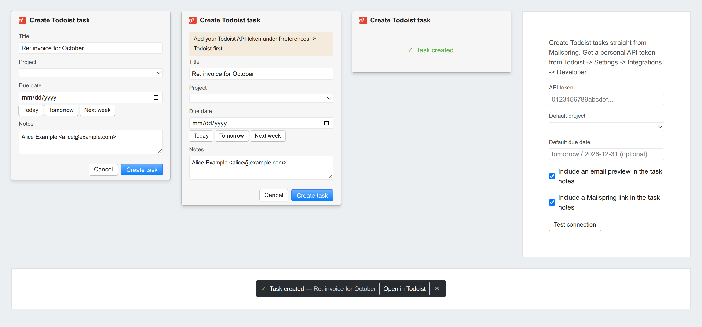

# Mailspring Todoist

Create [Todoist](https://todoist.com) tasks straight from [Mailspring](https://getmailspring.com).

Select a thread, click the Todoist button, and a small popover opens with the
task ready to edit: the subject as the title, the sender, a preview of the
thread and a link back into Mailspring in the notes.



## Features

- **A button in the thread list toolbar.** One click on the selected thread.
- **A create-task popover** styled like the rest of Mailspring: an editable
  title and notes, a project picker and a due date with *Today*, *Tomorrow*
  and *Next week* presets.
- **A link back to the email.** The notes carry a `mailspring://` link that
  reopens the thread in Mailspring.
- **A confirmation with a link.** A small toast appears when the task is
  created, names it and opens it in Todoist - even if the popover was
  dismissed while the request was in flight.
- **A preferences pane** for the API token, the default project and the
  default due date, with a *Test connection* button.
- **No runtime dependencies.** The plugin talks to Todoist's API v1 with
  node's own `https` module.

## Requirements

- Mailspring 1.6.3 or newer
- A Todoist personal API token (see [Configure](#configure))

## Install

### From a release (recommended)

1. Download the latest `mailspring-todoist-vX.Y.Z.zip` from the
   [releases page](https://github.com/oroszgy/mailspring-todoist/releases).
2. Unzip it - you get a folder named `mailspring-todoist`.
3. In Mailspring, choose **Developer > Install a Plugin...** and pick that
   folder.

Mailspring copies the folder into its packages directory and loads it right
away. Nothing else to do.

### By copying the folder yourself

Unzip the release into Mailspring's packages folder:

| System | Folder |
| --- | --- |
| Linux | `~/.config/Mailspring/packages/mailspring-todoist` |
| macOS | `~/Library/Application Support/Mailspring/packages/mailspring-todoist` |
| Windows | `%APPDATA%\Mailspring\packages\mailspring-todoist` |

Then restart Mailspring.

### From source

```bash
git clone https://github.com/oroszgy/mailspring-todoist.git
cd mailspring-todoist
npm install        # the TypeScript toolchain
npm run build      # compile src/ -> lib/ and check the stylesheet
npm run install-local   # copy the plugin into Mailspring's packages folder
```

Then restart Mailspring. For live feedback, turn on Developer Mode
(**Developer > Run with debug flags...**) and reload the main window after
a build.

## Configure

1. Get a personal API token from Todoist: **Settings > Integrations >
   Developer**.
2. In Mailspring, open **Preferences > Todoist** and paste the token.
3. Click **Test connection** - your projects load into the project picker.

The token is stored in Mailspring's own config file, in plain text. It never
leaves your machine except to reach `api.todoist.com`.

## Use

1. Select a thread in the thread list.
2. Click the Todoist button in the toolbar above the list.
3. Edit the title, the notes, the project or the due date.
4. **Create task**.

The task lands in Todoist with the title, the notes and - if you picked one -
the project and the due date. A toast at the bottom of the window confirms it
and links to the new task in Todoist.

## How it works

| File | Responsibility |
| --- | --- |
| `src/main.ts` | `activate` / `deactivate`, config schema, extension-point registration |
| `src/store.ts` | Settings stored via Mailspring's `AppEnv.config` |
| `src/todoist-client.ts` | Todoist API v1 client (node `https`, zero runtime deps) |
| `src/task-builder.ts` | Thread -> task draft (pure, testable) |
| `src/sender.ts` | Who wrote the last message in a thread |
| `src/due-date.ts` | The due date, as a date or as natural language |
| `src/create-popover.tsx` | The create-task popover |
| `src/task-notice.ts` | The "task created" notice, independent of React |
| `src/task-created-toast.tsx` | The confirmation toast in the main window |
| `src/thread-toolbar-button.tsx` | `ThreadActionsToolbarButton` |
| `src/todoist-icon.ts` | Todoist's mark, inlined from the official favicon |
| `src/preferences-tab.tsx` | Preferences pane |
| `scripts/package.js` | Builds the installable zip |
| `scripts/release.js` | Tags, pushes and publishes a release |
| `scripts/check-styles.js` | Compiles the stylesheet against the installed Mailspring |
| `scripts/render-screenshots.js` | Renders the screenshot in `docs/screenshots/` |

### Extension points used

- `ComponentRegistry.register(..., { role: 'ThreadActionsToolbarButton' })`
  - the button in the thread list toolbar. The component receives
  `props.items` (the selected threads), `props.selection` and `props.thread`
  (which is `items[0]`).
- `PreferencesUIStore.registerPreferencesTab(...)` - the pane in Mailspring's
  preferences.
- `ComponentRegistry.register(..., { location: WorkspaceStore.Sheet.Global.Footer })`
  - the toast at the bottom of the main window, on the same footer Mailspring
  uses for its undo toast.
- `Actions.openPopover(...)` / `Actions.closePopover()`

### The link back to the email

The notes carry a `mailspring://open-thread?subject=...&lastDate=...` link.
Mailspring's permalink handler matches the subject exactly and the timestamp
within 60 seconds, so the link reopens the thread it was made from.

### Styling

The plugin borrows Mailspring's own vocabulary: `.fixed-popover` supplies the
popover's chrome, and `input`, `select` and `.btn` are styled globally by
Mailspring. `styles/index.less` only lays the content out and fills the gaps
Mailspring leaves (labels, the textarea's border, spacing).

Mailspring swallows a LESS compile error and ships an **empty stylesheet**, so
a typo in a variable name would stay invisible until someone opened the
popover and found it unstyled. `npm run build` compiles the stylesheet against
the Mailspring installed on this machine and fails when it does not compile.

### The Todoist API

The plugin talks to the v1 API (`https://api.todoist.com/api/v1`) with a
bearer token. The older REST v2 and Sync v9 APIs are decommissioned (HTTP
410) - do not copy examples that use them. The contracts were verified against
Todoist's own sources; the write-up is in
[`docs/research/todoist-api-v1.md`](docs/research/todoist-api-v1.md), and the
Mailspring side in
[`docs/research/mailspring-contracts.md`](docs/research/mailspring-contracts.md).

## Troubleshooting

**The button is not there.**
Mailspring activates plugins when a window opens, so a Mailspring started
with `--background` - the mode it uses for mail notifications - never loads
the plugin at all. Start Mailspring normally and look again.

**The popover is unstyled.**
Mailspring shipped an empty stylesheet because the stylesheet did not compile.
Run `npm run check:styles` on a machine with Mailspring installed: it names
the offending variable.

**"Todoist request failed (401)".**
The token is wrong or expired. Make a new one at Todoist > Settings >
Integrations > Developer and paste it into Preferences > Todoist.

**The link in the notes does not open the thread.**
The permalink handler matches on the subject and a timestamp within 60
seconds. It opens the thread when the subject has not changed in the
 meantime; otherwise Mailspring has nothing to match.

## Develop

```bash
npm install
npm run build       # compile src/ -> lib/ and check the stylesheet
npm run watch       # compile on every change
npm test            # compile and run the tests
npm run check:styles  # the stylesheet check on its own
npm run install-local  # copy the plugin into Mailspring's packages folder
npm run package     # write dist/mailspring-todoist-vX.Y.Z.zip
npm run screenshots # redraw docs/screenshots/popover.png
npm run release -- v0.1.0   # tag, push and publish the release
```

The compiled plugin in `lib/` is committed on purpose: it is what Mailspring
loads, and it lets a user install the plugin straight from a checkout.

`npm run screenshots` needs Mailspring and Chrome on the machine - it renders
the real components with Mailspring's real stylesheets.

## Roadmap

The open issues are the roadmap:
[github.com/oroszgy/mailspring-todoist/issues](https://github.com/oroszgy/mailspring-todoist/issues).

## License

MIT - see [LICENSE](LICENSE).

Todoist and Mailspring are trademarks of their respective owners. This plugin
is not affiliated with, endorsed by, or sponsored by Todoist or Mailspring.
The Todoist mark is used to point at the product this plugin talks to.
